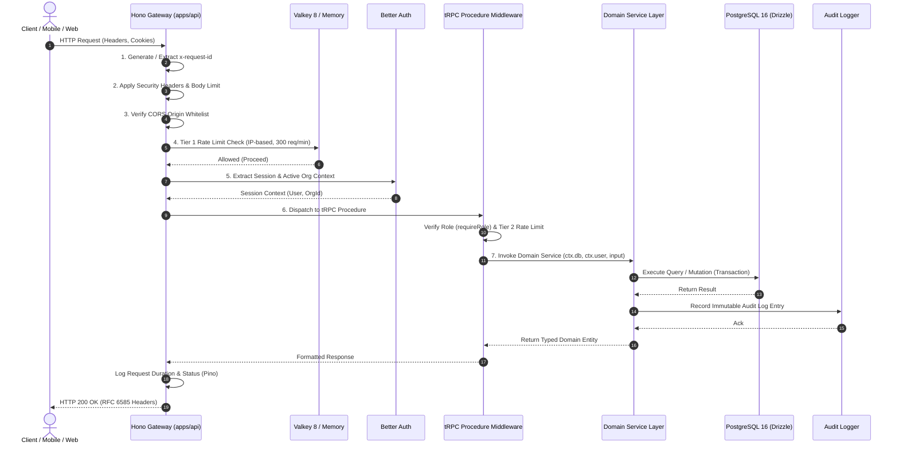
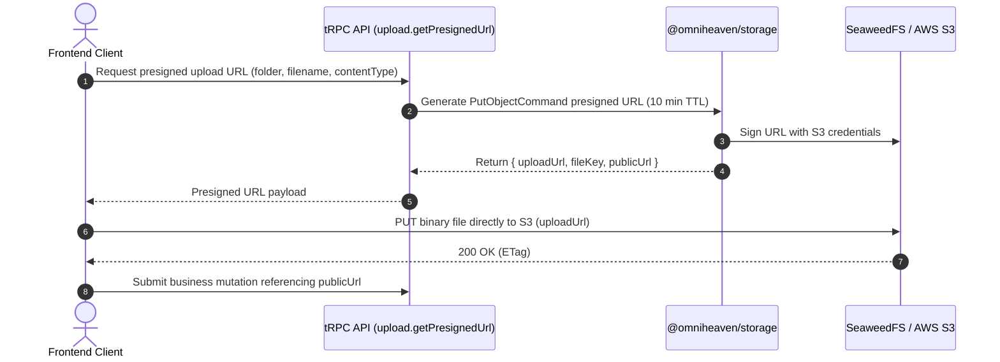

# omniHeaven Backend — Master Architectural Blueprint

> **Standard:** Enterprise Commercial Hospitality & Residential Estate Management  
> **Platform Target:** High-concurrency, dual-vertical (Residential Property + Hotel/Resort PMS)  
> **Primary Market:** Bangladesh Real Estate & Hospitality First, Global Extensible  
> **Last Updated:** October 19, 2026

---

## 1. System Overview & Monorepo Topology

omniHeaven utilizes a unified **Turborepo** monorepo orchestrated with **Bun workspaces**. The backend logic is isolated inside reusable shared packages in `packages/`, with `apps/api/` functioning as an ultra-fast, stateless HTTP gateway running **Hono**.

```text
├── apps/
│   └── api/                      # Hono HTTP Gateway (:4000) - CORS, rate limits, tRPC mount
├── packages/
│   ├── env/                      # Runtime Environment Variable validation (@t3-oss/env-core + Zod)
│   ├── logger/                   # Structured Pino logging with Correlation ID propagation
│   ├── errors/                   # Strongly-typed domain error hierarchy & code mapping
│   ├── email/                    # Nodemailer transport (Mailpit dev / SMTP production)
│   ├── storage/                  # S3 asset management (SeaweedFS / AWS S3 / Cloudflare R2)
│   ├── db/                       # PostgreSQL schema (24 tables), relations, Drizzle ORM
│   ├── auth/                     # Better Auth engine, sessions, organization plugin
│   ├── rate-limit/               # Valkey 8 / Redis atomic sliding window + in-memory fallback
│   ├── validators/               # Zod domain schemas, Bangladeshi NID & phone rules
│   ├── trpc/                     # tRPC v11 router, domain services, OpenAPI spec generator
│   └── typescript-config/        # Shared tsconfig presets (strict, noUncheckedIndexedAccess)
```

---

## 2. Request Lifecycle & Context Flow

Every request entering the omniHeaven API passes through a deterministic 7-stage pipeline before reaching domain business logic:



---

## 3. Multi-Tenancy & Authorization Architecture

### 3.1 Tenant Partitioning
Tenant isolation is enforced strictly at the database schema and query layer:
1. Every tenant-scoped table (`buildings`, `flats`, `renters`, `rental_contracts`, `bills`, `maintenance_requests`, `rooms`, `bookings`, `audit_logs`) includes an `organization_id` column with a non-null constraint and database foreign key referencing `organizations.id` with `onDelete: "cascade"`.
2. All tenant procedures use `orgProtectedProcedure`. This middleware extracts the organization ID from the `x-organization-id` header or the authenticated session's `activeOrganizationId`.
3. It performs a database membership verification check:
   ```typescript
   const membership = await ctx.db.query.members.findFirst({
     where: and(
       eq(schema.members.organizationId, orgId),
       eq(schema.members.userId, ctx.user.id)
     ),
   });
   ```
4. If no membership exists, it immediately throws `ErrorCode.ORG_FORBIDDEN` (HTTP 403), preventing cross-tenant data leakage.

### 3.2 Role-Based Access Control (RBAC) Matrix

| Capability | Superadmin | Owner | Admin | Manager | Staff | Member (Tenant/Guest) |
|---|:---:|:---:|:---:|:---:|:---:|:---:|
| **Platform HQ Control** | ✅ Full | ❌ None | ❌ None | ❌ None | ❌ None | ❌ None |
| **Manage Subscription & Billing Plan** | ✅ Full | ✅ Full | ❌ None | ❌ None | ❌ None | ❌ None |
| **Invite & Remove Team Members** | ✅ Full | ✅ Full | ✅ Non-Owners | ❌ None | ❌ None | ❌ None |
| **Create Buildings & Flats** | ✅ Full | ✅ Full | ✅ Full | ✅ Full | ❌ None | ❌ None |
| **Issue Rental Contracts** | ✅ Full | ✅ Full | ✅ Full | ✅ Full | ❌ None | ❌ None |
| **Generate Monthly Bills** | ✅ Full | ✅ Full | ✅ Full | ✅ Full | ❌ None | ❌ None |
| **Record Cash / Bank Payments** | ✅ Full | ✅ Full | ✅ Full | ✅ Full | ❌ None | ❌ None |
| **Adjust Advance Deposits** | ✅ Full | ✅ Full | ✅ Full | ❌ None | ❌ None | ❌ None |
| **View Immutable Audit Logs** | ✅ All Orgs | ✅ Own Org | ✅ Own Org | ❌ None | ❌ None | ❌ None |
| **Update Maintenance Work Orders** | ✅ Full | ✅ Full | ✅ Full | ✅ Full | ✏️ Status Only | ✏️ Own Flat Only |
| **View Personal Bills & Leases** | ❌ None | ❌ None | ❌ None | ❌ None | ❌ None | ✅ Own Leases Only |

### 3.3 Sole-Owner Invariant
An organization must always have at least one active member holding the `owner` role.
- If an owner attempts to leave an organization or has their role changed, the sole-owner check executes:
  ```typescript
  ensureOrganizationHasOwner(db, orgId, targetUserId);
  ```
- If `ownerCount <= 1`, the operation aborts with `ErrorCode.CANNOT_REMOVE_LAST_OWNER` (HTTP 400).

---

## 4. Error Handling Taxonomy & Standard API Response

All domain exceptions inherit from `DomainError` in `@omniheaven/errors`. When caught by tRPC, errors automatically translate into deterministic JSON error structures conforming to RFC 7807 problem details:

```typescript
export type ApiErrorResponse = {
  error: {
    code: string;         // e.g. "CANNOT_REMOVE_LAST_OWNER"
    message: string;      // Human-readable message in English or Bengali
    details?: Record<string, unknown>; // Contextual metadata
  };
  requestId: string;      // Trace correlation ID
};
```

### Domain Error Code Registry

| Error Code | HTTP Status | Domain | Cause |
|---|:---:|---|---|
| `AUTH_UNAUTHORIZED` | 401 | Auth | Missing, expired, or malformed authentication session token |
| `ORG_FORBIDDEN` | 403 | Auth | User does not have verified membership in requested organization |
| `ORG_SLUG_TAKEN` | 409 | Property | Requested organization slug already exists |
| `ORG_SUSPENDED` | 403 | Platform | Organization suspended by platform administration |
| `CANNOT_REMOVE_LAST_OWNER` | 400 | Auth | Operation would leave organization with 0 owners |
| `BUILDING_NOT_FOUND` | 404 | Property | Specified building ID does not exist in active organization |
| `FLAT_NOT_FOUND` | 404 | Property | Specified flat ID does not exist in building |
| `NID_INVALID_FORMAT` | 400 | Renter | NID number is not 10 digits (Smart) or 13/17 digits (Legacy) |
| `NID_ALREADY_ACTIVE` | 409 | Renter | Tenant with this NID already has an active overlapping lease |
| `CONTRACT_NOT_FOUND` | 404 | Renter | Specified rental contract does not exist |
| `BILL_NOT_FOUND` | 404 | Billing | Specified monthly invoice bill ID does not exist |
| `BILL_ALREADY_PAID` | 400 | Billing | Cannot modify or record excess payment on fully settled bill |
| `DEPOSIT_INSUFFICIENT` | 400 | Billing | Requested advance adjustment exceeds remaining security deposit |
| `ROOM_NOT_AVAILABLE` | 409 | Hotel | Room is occupied or has conflicting reservation dates |
| `ROOM_DIRTY_OR_MAINTENANCE` | 400 | Hotel | Cannot check in guest while room is in 'cleaning' or 'maintenance' state |
| `PLAN_QUOTA_EXCEEDED` | 403 | Platform | Adding units/rooms exceeds active SaaS subscription quota |

---

## 5. Security & Rate Limiting Architecture

### 5.1 Defense-in-Depth Layering
1. **HTTP Security Headers (`hono/secure-headers`):**
   - HSTS: `max-age=63072000; includeSubDomains; preload`
   - Content Sniffing: `X-Content-Type-Options: nosniff`
   - Frame Options: `X-Frame-Options: DENY`
   - Referrer Policy: `strict-origin-when-cross-origin`
2. **Request Body Limits (`hono/body-limit`):**
   - General API endpoints: Max 1MB payload.
   - S3 presigned asset upload endpoints: Max 15MB payload.
3. **Cross-Site Request Forgery (`hono/csrf`):**
   - Enforced across all state-mutating cookie-based authentication routes (`/api/auth/*`).
4. **Session Cookie Hardening:**
   - `HttpOnly`: true
   - `SameSite`: Lax
   - `Secure`: true in production
   - Expiration: 7-day rolling sliding window.

### 5.2 Two-Tier Sliding Window Rate Limiting
Backed by **Valkey 8** (`valkey/valkey:8-alpine`, Redis wire-compatible) via an atomic Lua script with millisecond precision:

| Tier | Layer | Identifier Key | Limit & Window | Purpose |
|---|---|---|---|---|
| **Tier 1** | Hono HTTP Gateway | Client IP (`cf-connecting-ip` / `x-forwarded-for`) | 300 req / 60s | DDoS, bot scanners, scraper shielding |
| **Tier 2** | tRPC Procedure (`AUTH_SENSITIVE`) | `auth:{ip}:{email}` | 5 req / 15m | Brute-force login / password reset protection |
| **Tier 2** | tRPC Procedure (`INVITATIONS`) | `invitations:{userId}` | 10 req / 1h | Member invite spam prevention |
| **Tier 2** | tRPC Procedure (`PUBLIC_READ`) | `public:{ip}` | 120 req / 60s | Public hotel availability & slug queries |
| **Tier 2** | tRPC Procedure (`MUTATIONS_STANDARD`)| `mutations:{userId}:{orgId}` | 60 req / 60s | Standard dashboard write operations |
| **Tier 2** | tRPC Procedure (`MUTATIONS_BULK`) | `bulk:{orgId}` | 10 req / 5m | Mass flat generation & batch invoice runs |

**Fail-Open In-Memory Resiliency:** If Valkey/Redis becomes unreachable, the rate limiter automatically falls back to an in-memory sliding window cache with warning telemetry, ensuring transient caching outages never cause system downtime.

---

## 6. Storage & Asset Management

### 6.1 S3 Storage Architecture
Powered by `@omniheaven/storage` using `@aws-sdk/client-s3`. Local development runs **SeaweedFS** (`chrislusf/seaweedfs`) inside Docker on port 8333 with S3 compatibility. Production supports AWS S3, Cloudflare R2, or MinIO.



### 6.2 Asset Categorization & Privacy
- **Public Assets:** Hotel room photos, property building banners, organization logos. (Served via public CDN URL).
- **Private Sensitive Documents:** Bangladeshi NID scans, tenant digital signatures, signed rental contract PDFs. (Stored in private bucket; accessed exclusively via 60-minute time-limited `getPresignedReadUrl` signed tokens).

---

## 7. Email Service & Notification Architecture

Email delivery is managed via `@omniheaven/email` wrapping Nodemailer:
- **Development:** Dispatches to **Mailpit** (Docker port 1025) with web inspection at `http://localhost:8025`.
- **Production:** Configurable via environment variables (`SMTP_HOST`, `SMTP_PORT`, `SMTP_USER`, `SMTP_PASS`, `SMTP_SECURE`).
- **Transactional Templates:**
  1. `verify-email`: Sent upon user signup with a secure verification URL.
  2. `reset-password`: Sent upon password reset request with a 15-minute token link.
  3. `team-invitation`: Sent to invited members with role details and organization branding.
  4. `bill-invoice`: Sent to tenants with monthly rent breakdown and bKash payment instructions.

---

## 8. Bangladeshi Localization & Financial Invariants

To achieve complete fidelity with local Bangladeshi real estate practices, the backend strictly implements:

1. **Currency Precision:**
   - Currency: BDT (Bangladeshi Taka - ৳).
   - Stored in database as `numeric(12, 2)` to eliminate JavaScript floating-point errors.
   - All arithmetic (penalties, interest, utility totals) calculated via fixed decimal precision.
2. **National Identity Card (NID) Rules:**
   - **Smart NID:** Exactly 10 digits (`^\d{10}$`).
   - **Legacy 17-digit NID:** 4-digit birth year + 13 numeric digits (`^\d{17}$`).
   - **Legacy 13-digit NID:** Auto-normalized by prefixing 4-digit birth year.
3. **Medical Safety (Blood Group):**
   - Mandatory on all renter profiles: `'A+' | 'A-' | 'B+' | 'B-' | 'AB+' | 'AB-' | 'O+' | 'O-'`.
4. **Advance / Security Deposit Ledger:**
   - In Bangladesh, 1–3 months rent is collected in advance as a security deposit.
   - **Core Invariant:** `remainingDepositBalance` must never be directly overwritten. Every adjustment against unpaid bills or move-out settlements must record an immutable row in `advance_adjustments` with before/after balances.
5. **Mobile Network Operator Validation:**
   - Format: `+8801[3-9]\d{8}` (normalized to `01[3-9]\d{8}`).

---

## 9. Interactive API Documentation & OpenAPI 3.1

The backend generates an OpenAPI 3.1 specification directly from tRPC procedure definitions using `trpc-to-openapi`:
- Served as raw JSON at `GET /api/openapi.json`.
- Rendered interactively via **Scalar UI** (`@scalar/hono-api-reference`) at `GET /api/docs`.
- Every external procedure includes an `OpenApiMeta` tag defining HTTP method, path, tags, and summary.
